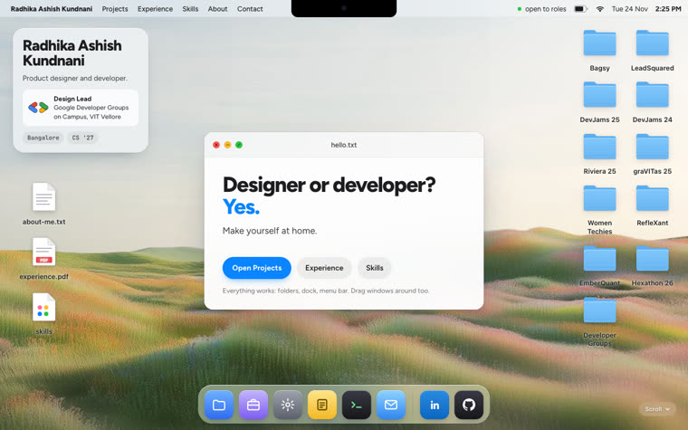
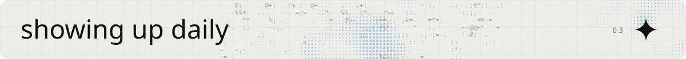

<p align="center">
  
</p>

<p align="center">
  <a href="https://radhikakundnani.github.io/"></a>
  <a href="https://linkedin.com/in/radhika-kundnani"></a>
  <a href="mailto:radhikakundnani1@gmail.com"></a>
</p>

```text
        .--.                        \ | /               .--.
     .-(    ).          .--.       -- ☀ --          .-(    ).
    (___.__)__)      .-(    ).      / | \          (___.__)__)
                    (___.__)__)            ~ 14:40, somewhere high up

  radhika@vit:~$ whoami
  > a cs student at vit vellore who could never pick between
    designing things and building them, so i do both.
  > i like turning messy, manual work into ai that just handles it,
    and making it feel nice to use.
  > happiest somewhere high up, looking at a city from the clouds.

  radhika@vit:~$ ls ./life
  ai-agents/   design/   products/   research/   views/
```

<p align="center">
  <sub>
    <b>lately</b> · ai engineering intern @ mindmap digital &nbsp;·&nbsp; design lead @ gdg on campus vit &nbsp;·&nbsp; freelance design for founders
    <br>
    <b>now</b> · open to internships & new-grad roles · building agents, practising dsa, saying yes to good problems
  </sub>
</p>


<table>
  <tr>
    <td width="33%" valign="top">
      <a href="https://github.com/radhikakundnani/bagsy"></a>
      <h4>bagsy</h4>
      <sub>a trip planner for friends who overpack. it reads the weather for your dates, builds the list, and sorts anything you add with a little ml model i trained.</sub>
      <br><br><sub><a href="https://bagsy-pi.vercel.app/">try it</a> · <a href="https://github.com/radhikakundnani/bagsy">code</a></sub>
    </td>
    <td width="33%" valign="top">
      <a href="https://radhikakundnani.github.io/"></a>
      <h4>my portfolio</h4>
      <sub>it's a tiny desktop. folders, a dock, windows you can drag around. all my design work lives in there.</sub>
      <br><br><sub><a href="https://radhikakundnani.github.io/">come in</a></sub>
    </td>
    <td width="33%" valign="top">
      <a href="https://radhikakundnani.github.io/composio-toolkit-feasibility/"></a>
      <h4>agents checking agents</h4>
      <sub>an ai pipeline that researched 100 apps, with a second agent trying to prove the first one wrong.</sub>
      <br><br><sub><a href="https://radhikakundnani.github.io/composio-toolkit-feasibility/">case study</a> · <a href="https://github.com/radhikakundnani/composio-toolkit-feasibility">code</a></sub>
    </td>
  </tr>
</table>

<p align="center"><sub>+ a research paper on explainable ml for healthcare (under review), and more in the portfolio ✦</sub></p>


<p align="center">
  
</p>
<p align="center">
  <sub><code>llms & agents</code> <code>n8n</code> <code>gemini</code> <code>framer</code> <code>design systems</code></sub>
</p>



<p align="center">
  
</p>

<p align="center">
  <a href="mailto:radhikakundnani1@gmail.com"></a>
</p>
