<p align="center">
  
</p>

<p align="center">
  <a href="https://radhikakundnani.github.io/"></a>
  <a href="https://linkedin.com/in/radhika-kundnani"></a>
  <a href="mailto:radhikakundnani1@gmail.com"></a>
</p>

```text
         .  :  ;  -=+*%#@  cloud.txt              ✦
     .-~~~-.            .-~~~~-.        ,                .-~~-.
   (  .  :  )~-.     (  :  =  +  )    *  .   ✦        (  . : )
    `~~~~~~~~~'       `~~~~~~~~~'                    `~~~~~'

  radhika@vit:~$ whoami
  > cs undergrad at vit vellore (class of 2027), based in bangalore.
  > i build ai automations and full-stack web apps, and design the
    interfaces for them too.
  > interned as an ai engineer at mindmap digital, building llm
    workflows and an email agent for sales teams.

  radhika@vit:~$ ls ./work
  ai-agents/   full-stack/   ui-ux-design/   ml-research/
```

<p align="center">
  <sub>
    <b>lately</b> · ai engineering intern @ mindmap digital &nbsp;·&nbsp; design lead @ gdg on campus vit &nbsp;·&nbsp; freelance design for founders
    <br>
    <b>now</b> · open to internships & new-grad roles · building ai agents and practising dsa
    <br>
    <b>for fun</b> · i collect design inspiration on <a href="https://in.pinterest.com/qtfrootie/">pinterest</a>
  </sub>
</p>



<table>
  <tr>
    <td width="33%" valign="top">
      <a href="https://github.com/radhikakundnani/bagsy"></a>
      <h4>bagsy</h4>
      <sub>a trip planner for friends who overpack. it reads the weather for your dates, builds the list, and sorts anything you add with a little ml model i trained.</sub>
      <br><br><sub><a href="https://bagsy-pi.vercel.app/">try it</a> · <a href="https://github.com/radhikakundnani/bagsy">code</a></sub>
    </td>
    <td width="33%" valign="top">
      <a href="https://radhikakundnani.github.io/"></a>
      <h4>my portfolio</h4>
      <sub>it's a tiny desktop. folders, a dock, windows you can drag around. all my design work lives in there.</sub>
      <br><br><sub><a href="https://radhikakundnani.github.io/">come in</a></sub>
    </td>
    <td width="33%" valign="top">
      <a href="https://radhikakundnani.github.io/composio-toolkit-feasibility/"></a>
      <h4>agents checking agents</h4>
      <sub>an ai pipeline that researched 100 apps, with a second agent trying to prove the first one wrong.</sub>
      <br><br><sub><a href="https://radhikakundnani.github.io/composio-toolkit-feasibility/">case study</a> · <a href="https://github.com/radhikakundnani/composio-toolkit-feasibility">code</a></sub>
    </td>
  </tr>
</table>

<p align="center"><sub>+ a research paper on explainable ml for healthcare (under review), and more in the portfolio ✦</sub></p>


<p align="center">
  
</p>
<p align="center">
  <sub><code>llms & agents</code> <code>n8n</code> <code>gemini</code> <code>framer</code> <code>design systems</code></sub>
</p>


<p align="center">
  
</p>

<p align="center">
  <a href="mailto:radhikakundnani1@gmail.com"></a>
</p>
