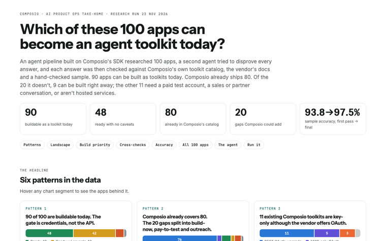

<p align="center">
  
</p>

<p align="center">
  <a href="https://radhikakundnani.github.io/"></a>
  <a href="https://linkedin.com/in/radhika-kundnani"></a>
  <a href="mailto:radhikakundnani1@gmail.com"></a>
  <a href="https://bagsy-pi.vercel.app/"></a>
</p>

```text
                   .            *                 .        ✦
       *                  .-""""-.        .                     .
             .          .'  .  .  '.            *        .
     .                 /   .  ()  . \     ___________________
                 *     |  .      .   | ==( drifting through   )
        .              \   .    .   /     \ code & design    /
                 .      '.  .  .  .'       '----------------'
     ✦                    '-....-'      .           *
              .        *          .          .               .

  radhika@vit:~$ whoami
  > cs @ vit vellore, class of 2027 · bangalore
  > i take messy real-world workflows, automate them with llms,
    design the interface, and ship the code. end to end.

  radhika@vit:~$ cat now.txt
  > building ai agents that double-check their work
  > grinding dsa daily · learning genai on google cloud
  > open to internships & new-grad roles · available now

  radhika@vit:~$ █
```


<table>
  <tr>
    <td width="50%" valign="top">
      <a href="https://github.com/radhikakundnani/bagsy"></a>
      <h4>bagsy · <a href="https://bagsy-pi.vercel.app/">live</a> · <a href="https://github.com/radhikakundnani/bagsy">code</a></h4>
      <sub>a collaborative trip planner. packing lists built from the real weather on your dates, gemini suggestions, group trips with server-side access control, and an ml model i trained that sorts items as you type (33% → <b>84%</b>).</sub>
      <br><sub><code>react</code> <code>node.js</code> <code>mongodb</code> <code>gemini</code> <code>scikit-learn</code></sub>
    </td>
    <td width="50%" valign="top">
      <a href="https://radhikakundnani.github.io/"></a>
      <h4>portfolio · <a href="https://radhikakundnani.github.io/">open it</a></h4>
      <sub>my portfolio is a little desktop: folders, a dock, a menu bar, windows you can drag around. every project and design i've made lives in there. designer or developer? yes.</sub>
      <br><sub><code>javascript</code> <code>html</code> <code>css</code> <code>design</code></sub>
    </td>
  </tr>
  <tr>
    <td width="50%" valign="top">
      <a href="https://radhikakundnani.github.io/composio-toolkit-feasibility/"></a>
      <h4>agent toolkit feasibility · <a href="https://radhikakundnani.github.io/composio-toolkit-feasibility/">case study</a> · <a href="https://github.com/radhikakundnani/composio-toolkit-feasibility">code</a></h4>
      <sub>an agent pipeline that researched 100 apps for ai-agent toolkit feasibility (auth, self-serve vs gated, api surface, mcp), with a second agent trying to disprove every answer and hand-checked samples.</sub>
      <br><sub><code>python</code> <code>composio sdk</code> <code>llm agents</code></sub>
    </td>
    <td width="50%" valign="top">
      <h4>interpretable kidney disease risk · <i>research paper, under review</i></h4>
      <sub>instead of a black-box model: rough sets + a whale optimization algorithm cut 24 clinical attributes down to 6 (k-nn 96.25% → <b>97.50%</b>), checked with nested cross-validation and a wilcoxon test, then formal concept analysis turned it into 12 decision rules a doctor can actually read.</sub>
      <br><sub><code>python</code> <code>scikit-learn</code> <code>rough set theory</code> <code>fca</code></sub>
      <br><br>
      <h4>also</h4>
      <sub>n8n + llm automations and an outlook email agent from my ai engineering internship at mindmap digital, and a lot of design: hackathon branding for gdg on campus, and the official websites for vit's tech fest (gravitas) and cultural fest (riviera). it's all in the portfolio.</sub>
    </td>
  </tr>
</table>


<p align="center">
  
</p>
<p align="center">
  <code>llm apis</code> <code>ai agents</code> <code>prompt engineering</code> <code>n8n</code> <code>gemini</code> <code>transformers.js</code> <code>pandas</code> <code>numpy</code> <code>supabase</code> <code>oracle cloud</code> <code>framer</code> <code>design systems</code>
</p>
<p align="center"><sub>☁ oci 2025 generative ai professional</sub></p>


<p align="center">
  
</p>

<p align="center">
  <a href="mailto:radhikakundnani1@gmail.com"></a>
</p>
