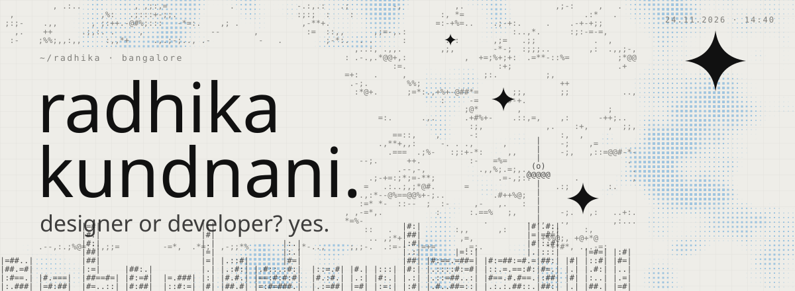

<p align="center">
  
</p>

<p align="center">
  <a href="https://radhikakundnani.github.io/"></a>
  <a href="https://linkedin.com/in/radhika-kundnani"></a>
  <a href="mailto:radhikakundnani1@gmail.com"></a>
  <a href="https://bagsy-pi.vercel.app/"></a>
</p>

```text
        .  *        .       *         .      .     *
   *         .   ___   .          *                 .
       .        /   \  ~~~ orbiting ~~~   .    *
  .        *   | ( ) |       .        *        .
     .          \___/   .         .        *
          *      /|\       *    .     .            *

  radhika@vit:~$ whoami
  > cs undergrad @ vit vellore (class of 2027) · bangalore, in
  > i map messy real-world workflows, automate them with llms,
    design the interface, and ship the code end to end.

  radhika@vit:~$ cat now.txt
  > building ai agents + verification loops
  > grinding dsa daily · learning cloud + genai on google's stack
  > open to internships & new-grad roles · available now

  radhika@vit:~$ _
```


### ✦ things i've built

<table>
  <tr>
    <td width="50%" valign="top">
      <a href="https://github.com/radhikakundnani/bagsy"><b>bagsy</b></a> · <a href="https://bagsy-pi.vercel.app/">live</a><br>
      <sub>Collaborative trip planner. Packing lists built from the real weather forecast for your dates, Gemini suggestions as schema-validated JSON, group trips with server-side access control and integration tests, and a text classifier I trained that sorts items as you type (33% → <b>84%</b>, 5-fold CV), served in Node via Transformers.js.</sub><br><br>
      <a href="https://github.com/radhikakundnani/bagsy"></a>
      <br><sub><code>React</code> <code>Node.js</code> <code>Express</code> <code>MongoDB</code> <code>Gemini</code> <code>scikit-learn</code></sub>
    </td>
    <td width="50%" valign="top">
      <a href="https://github.com/radhikakundnani/composio-toolkit-feasibility"><b>composio-toolkit-feasibility</b></a> · <a href="https://radhikakundnani.github.io/composio-toolkit-feasibility/">case study</a><br>
      <sub>An agent pipeline that researches 100 apps for AI-agent toolkit feasibility (auth, self-serve vs gated, API surface, MCP), with layered verification and a charted case study of the patterns.</sub>
      <br><br><sub><code>Python</code> <code>Composio SDK</code> <code>LLM agents</code></sub>
      <br><br>
      <b>interpretable CKD risk assessment</b> · <i>research paper, under review</i><br>
      <sub>Rough sets + a binary Whale Optimization Algorithm cut 24 clinical attributes to a 6-feature reduct (k-NN 96.25% → <b>97.50%</b>), validated with nested 3×5 cross-validation and a Wilcoxon test, then Formal Concept Analysis turned it into 12 readable decision rules. Equal-contribution author.</sub>
      <br><br><sub><code>Python</code> <code>scikit-learn</code> <code>rough set theory</code> <code>FCA</code></sub>
      <br><br>
      <a href="https://radhikakundnani.github.io/"><b>portfolio</b></a><br>
      <sub>Everything else, including my design work.</sub>
    </td>
  </tr>
</table>


### ✦ where i've been

```text
  ◉  ai engineering intern ············ mindmap digital, bangalore   may–jul 2025
     n8n + llm automations for sales & ops · an outlook email agent that
     classifies intent and drafts replies · a linkedin lead generator for crm

  ◉  design lead, events ·············· gdg on campus, vit vellore   2024–2026
     branding & design for gdg's hackathons: devjams, hexathon and
     women techies (2,000+ participants)

  ◉  official websites ················· gravitas'26 & riviera'25, vit vellore
     gravitas = vit's annual tech fest (40,000+ participants),
     riviera = vit's annual cultural fest · full design systems + hi-fi prototypes

  ◉  freelance product designer & dev ·· emberquant, reflxnt          2025–2026
     brand goals → wireframes → responsive sites in framer

  ◉  product case study ················ leadsquared self-serve automations
     user research, rice across six options, a prd with acceptance criteria
```


### ✦ stack

<p align="center">
  
</p>
<p align="center">
  <code>LLM APIs</code> <code>AI agents</code> <code>prompt engineering</code> <code>n8n</code> <code>Gemini</code> <code>Transformers.js</code> <code>pandas</code> <code>NumPy</code> <code>Supabase</code> <code>Oracle Cloud</code> <code>Framer</code> <code>design systems</code>
</p>
<p align="center"><sub>☁ OCI 2025 Generative AI Professional (Oracle)</sub></p>


### ✦ signal

<p align="center">
  
</p>

<p align="center">
  
</p>
